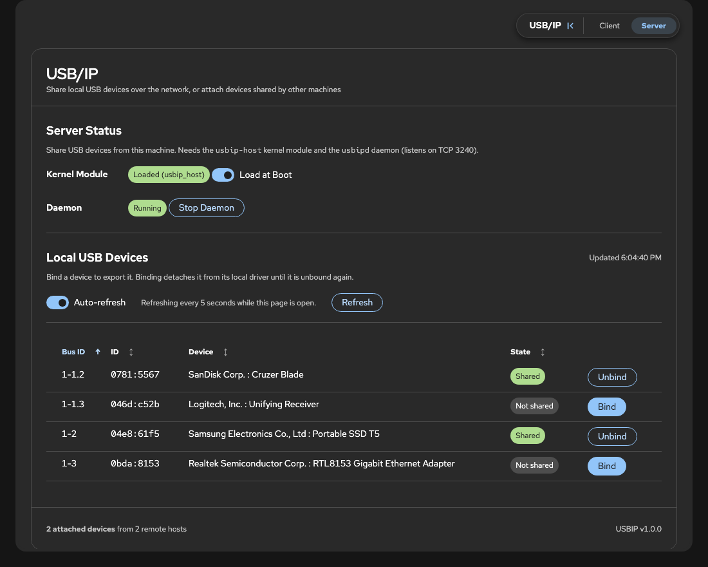
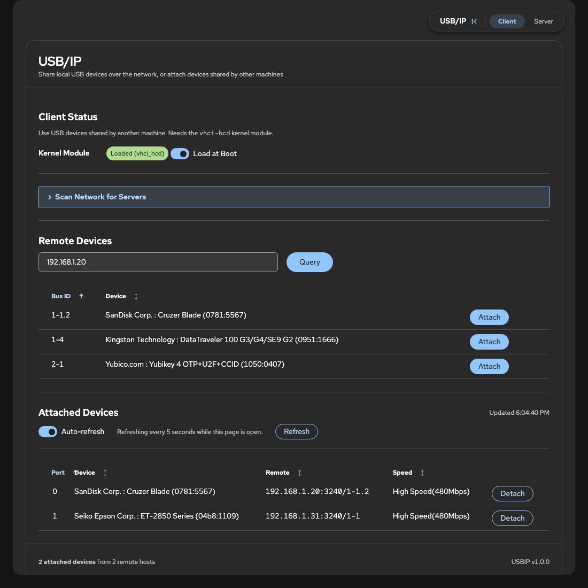
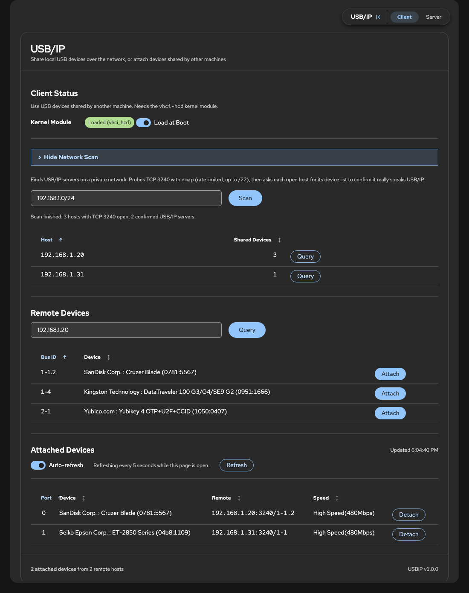

# cockpit-usbip

[Cockpit](https://cockpit-project.org/) tool page for managing [USB/IP](https://docs.kernel.org/usb/usbip_protocol.html) from the web interface: share the USB devices of one machine and use them on another as if they were plugged in locally. **Client** and **Server** are separate entries in the page menu, so the same package works on either side.

Requires no build step: just static HTML/CSS/JS dropped into a Cockpit package directory. Built from [Crewdriver](https://github.com/Crewpit/crewdriver) and installable with [Crewmate](https://github.com/Crewpit/crewmate).

## What it does

Changing anything (modules, daemon, bind, attach) needs Cockpit's administrative access. Without it the page stays usable for looking around, shows a notice and disables those controls. The lists refresh every 5 seconds while a page is open, and the footer always shows how many devices are attached and from how many servers.

### Server

Run this on the machine the USB devices are plugged into. **Load at Boot** loads `usbip-host` now and on every boot, the daemon (`usbipd`, TCP 3240) can be started and stopped, and each local device has a **Bind** / **Unbind** button to share it or stop sharing it. A bound device is taken away from the local machine until it is unbound.



### Client

Run this on the machine that wants to use the devices. **Load at Boot** does the same for `vhci-hcd`. Enter a server and **Query** it to list what it shares, then **Attach** a device. Attached devices show their port, speed and the server they come from, with **Detach** to release them.



### Scan Network

Collapsed by default, under Client. Enter a range and `nmap` probes TCP 3240, then every host that answers is asked for its device list with `usbip list -r`, so other services on that port are dropped. **Query** on a result fills in the host.

Only private ranges are accepted (10/8, 172.16/12, 192.168/16, 100.64/10, 169.254/16, 127/8), up to a /22. It uses plain TCP connects (no root), rate limited, with a 5 second limit per host, confirms at most 64 hosts four at a time, and can be cancelled.



*Screenshots show dummy devices. Light theme versions of each are in [`screenshots/`](screenshots).*

## Layout

- `manifest.json` - package metadata, tells the Cockpit shell about this tool
- `preflight.json` - the commands it needs (`usbip`, `usbipd`, `modprobe`, `nmap`, `readlink`, `pgrep`, `pkill`) and the packages that provide them
- `index.html` - page markup (one pane per page: Client and Server)
- `index.js` - the two pages: the `MENU` declaration, usbip parsing, bind/attach actions, boot loading, network scan
- `functions.js` - reusable features exposed as `window.App` (menu, alerts, sortable table, clipboard, polling...)
- `theme.js` - keeps the dark/light theme in sync with the shell
- `index.css`, `cockpit-glue.css` - page styles and the layout glue every embedded Cockpit page needs
- `vendor/patternfly/` - vendored PatternFly CSS

## Installing

The target machine needs Cockpit 175 or newer and the commands listed in `preflight.json`: `usbip`, `usbipd`, `modprobe`, `nmap`, `readlink`, `pgrep` and `pkill`.

### Recommended: Crewmate

Try [Crewmate](https://github.com/Crewpit/crewmate) first. It is the recommended package manager for Crewpit apps and can install **cockpit-usbip** straight from this repository, [Crewpit/cockpit-usbip](https://github.com/Crewpit/cockpit-usbip).

### Manual

Get the code, then copy it into `/usr/share/cockpit/cockpit-usbip` on the machine you want to share or use USB devices on:

```bash
git clone https://github.com/Crewpit/cockpit-usbip.git
cd cockpit-usbip
```

With `rsync` (needs `rsync` on both ends):

```bash
rsync -rvh --exclude .git --exclude screenshots ./ root@<host>:/usr/share/cockpit/cockpit-usbip/
```

Or with `scp`:

```bash
scp -r . root@<host>:/usr/share/cockpit/cockpit-usbip
```

If you are already on the target machine, `cp -r . /usr/share/cockpit/cockpit-usbip` as root does the same.

Reload Cockpit in the browser and **USB/IP** shows up in the sidebar under Tools. Cockpit lists a package's files when you log in, so after adding a new file (not just editing one), log out and back in or it will 404.

To update, pull the latest changes and copy them over again.
